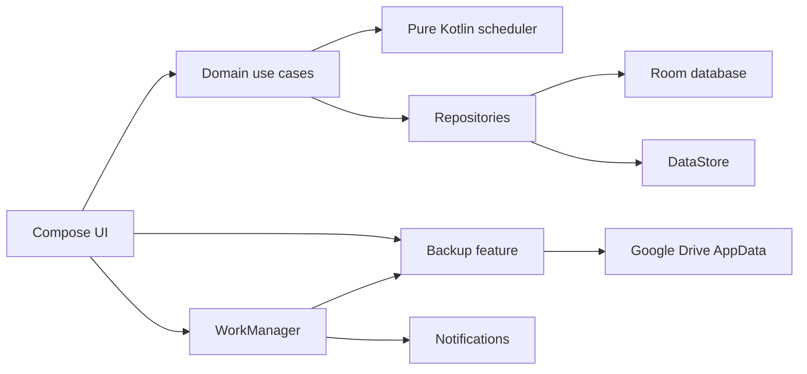

<p align="center">
  
</p>

<h1 align="center">Hifz Companion</h1>

<p align="center">
  A private, offline-first Android revision scheduler for maintaining Qur'an memorization.
</p>

<p align="center">
  <a href="https://github.com/salmanfs815/HifzCompanion/releases/latest"></a>
  
  
  <a href="LICENSE"></a>
</p>

Hifz Companion turns memorized pages into a manageable daily revision plan. It prioritizes fragile pages, balances new and long-term revision, records recitation quality, and keeps the core experience fully functional without an account or internet connection.

## Download

Download the latest signed APK from [GitHub Releases](https://github.com/salmanfs815/HifzCompanion/releases/latest).

The app is currently distributed directly rather than through Google Play. On first install, Android will ask you to allow installation from the browser or file manager that opened the APK. You can disable that permission again after installation.

Requirements: Android 8.0 (API 26) or newer.

When upgrading, install the newer APK over the existing app. Do not uninstall first unless you have made and verified a Google Drive backup. Each official update is signed with the same release certificate.

## Features

- Three purpose-built queues: new, long-term, and recovery
- Configurable spaced-repetition schedules and daily capacity
- Strong, Good, Weak, and Failed recitation ratings
- Same-day activity history with rating correction
- Manual review logging by page, Surah, or Juz
- Statistics, streaks, backlog indicators, and memorization health
- Morning, evening, and weekly reminder scheduling
- Light, dark, and system themes with adaptive Compose layouts
- Local Room storage with no account required
- Optional Google Drive AppData backup and restore

## How scheduling works

New pages follow a short stabilization schedule. Stable pages enter a configurable long-term rotation. Weak and Failed ratings move a page into their configurable recovery schedules, where it must earn consecutive Strong ratings before returning to rotation. Recovery work is prioritized, while daily capacity and overload settings keep backlogs realistic.

See the [user guide](docs/USER_GUIDE.md) for rating guidance, backup instructions, and update safety.

## Privacy

Hifz Companion is local-first and contains no ads or third-party tracking. Revision data stays on the device unless the user explicitly enables Google Drive backup. Drive access is limited to the app's private `appDataFolder`; the app cannot browse personal Drive files.

Drive backups are stored as a versioned JSON snapshot in the app's private Google Drive AppData area. They are protected by the user's Google Account and Drive permissions but are not additionally end-to-end encrypted by Hifz Companion. Read the full [privacy and data document](docs/PRIVACY.md).

## Architecture



The project uses modular clean architecture:

| Module | Responsibility |
|---|---|
| `app` | Compose screens, navigation, onboarding, and application wiring |
| `core-domain` | Models, repository contracts, and application use cases |
| `core-data` | Room, DataStore, migrations, and repository implementations |
| `scheduler` | Android-independent scheduling and queue policy |
| `backup` | Google authorization, versioned snapshots, Drive storage, and background backup |
| `settings` | Scheduler, notification, appearance, and backup controls |
| `analytics` | Local health and progress calculations |
| `notifications` | Reminder workers and notification channels |
| `core-ui` | Shared Compose components and memorization selectors |

More detail is available in [Architecture](docs/ARCHITECTURE.md).

## Technology

- Kotlin and Coroutines/Flow
- Jetpack Compose and Material 3
- Navigation 3 and adaptive layouts
- Room and Preferences DataStore
- Hilt dependency injection
- WorkManager
- Google Identity Services and Drive API
- Tink/Android Keystore for local secrets

## Build locally

1. Clone the repository.
2. Open it in a current Android Studio installation.
3. Allow Gradle to install the configured JDK toolchains and dependencies.
4. Run the `app` configuration on an Android 8.0+ emulator or device.

The offline app works without Google configuration. To develop the Drive feature, follow [Google Drive OAuth setup](docs/OAUTH_SETUP.md).

```powershell
.\gradlew.bat testDebugUnitTest
.\gradlew.bat lintDebug
.\gradlew.bat assembleDebug
```

Instrumented Compose tests require an emulator or device:

```powershell
.\gradlew.bat connectedDebugAndroidTest
```

See [Testing](docs/TESTING.md) for the test strategy and release checklist.

Maintainers can follow [Releasing](docs/RELEASING.md) to version, sign, verify, checksum, tag, and publish an APK without committing signing material.

## Contributing

Issues and focused pull requests are welcome. Please include tests for scheduler, persistence, or backup behavior changes and keep the core experience usable offline.

## License

Hifz Companion is available under the [MIT License](LICENSE).
