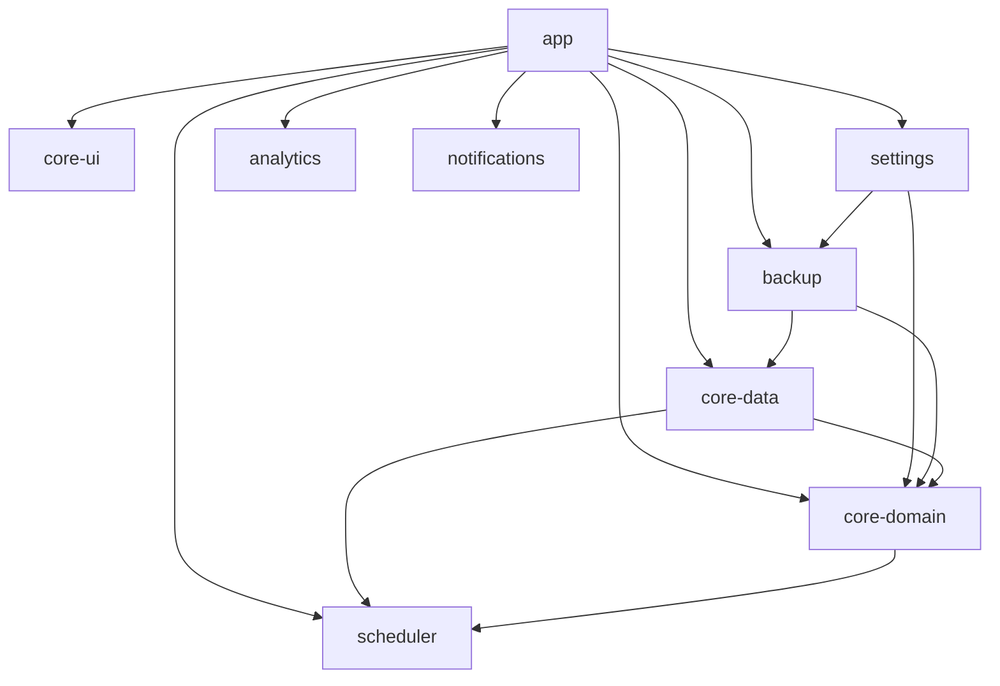
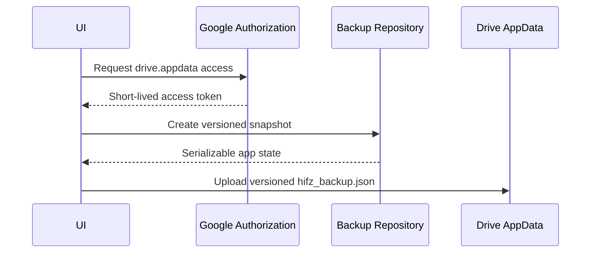

# Architecture

Hifz Companion is a modular, local-first Android application. UI code depends on domain contracts; persistence and Google services remain behind implementations. The scheduling engine is a pure Kotlin module with no Android dependency, allowing deterministic JVM tests.

## Module boundaries

Hilt connects repository contracts, Drive storage, local cryptography, ViewModels, and WorkManager workers at the application boundary.

## Local data flow

Compose observes ViewModel state exposed through Kotlin Flow. Use cases read repository contracts and pass scheduling decisions to `HifzScheduler`. Repository implementations persist progress, review history, and scheduler state through Room; preferences such as theme and capacity are stored through DataStore.

Review corrections replay recorded history rather than only overwriting the current state. This preserves the invariant that a page's queue, strength, stage, and next date are derived from its review sequence.

## Backup flow

Drive backups are versioned JSON snapshots stored in the user's private AppData area. Decoding and snapshot-version validation complete before repository restore, so a malformed or unsupported file cannot partially overwrite local data.

Runtime OAuth access tokens are encrypted locally with a Tink key protected by Android Keystore. Tokens are disposable and deliberately excluded from Android system backup.

## Offline guarantees

Room and DataStore are authoritative for normal operation. Network access is used only for user-initiated or scheduled Google Drive backup. Authorization failure never prevents onboarding from being skipped or revision features from working.
